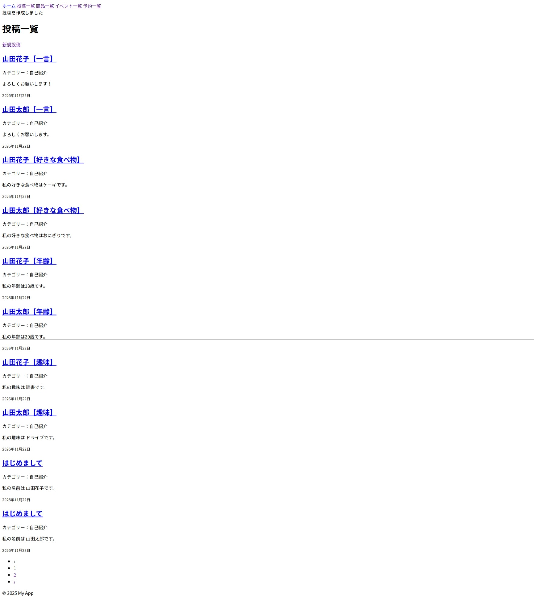
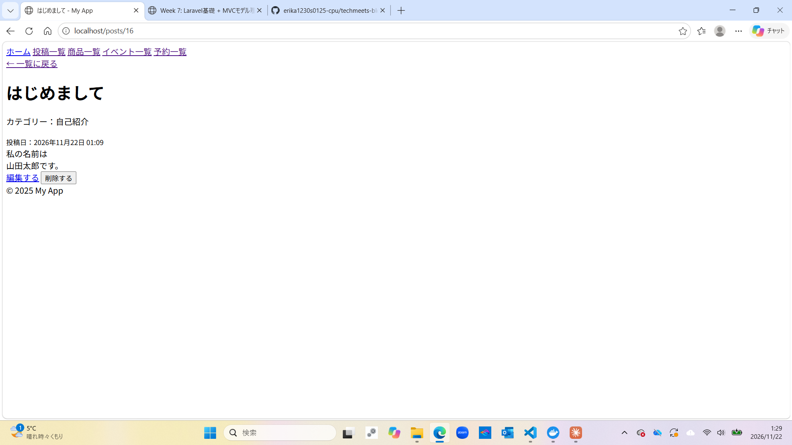
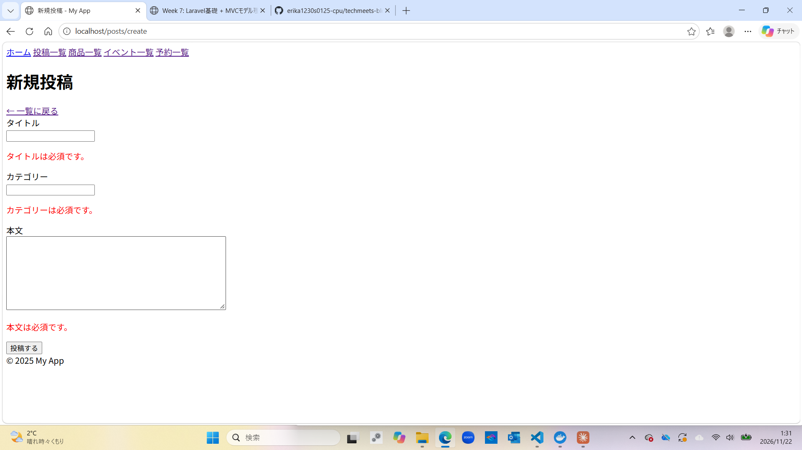
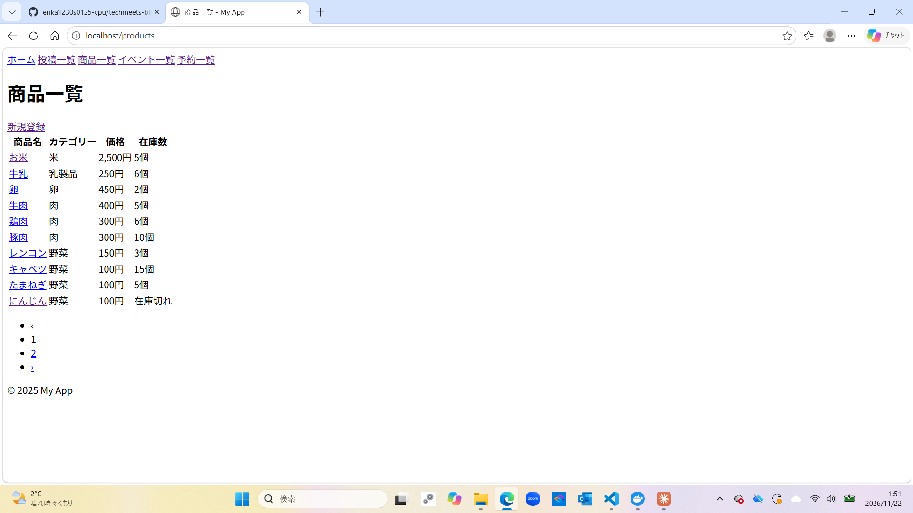
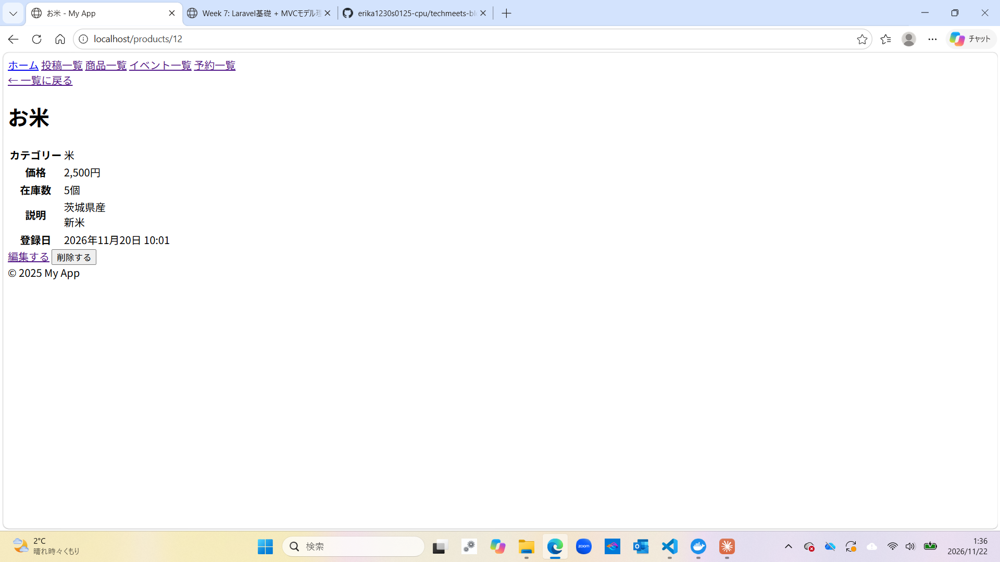
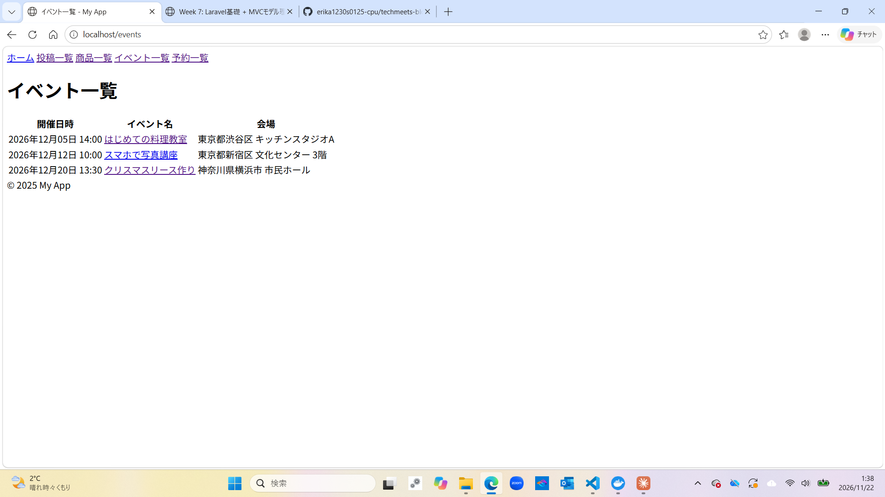
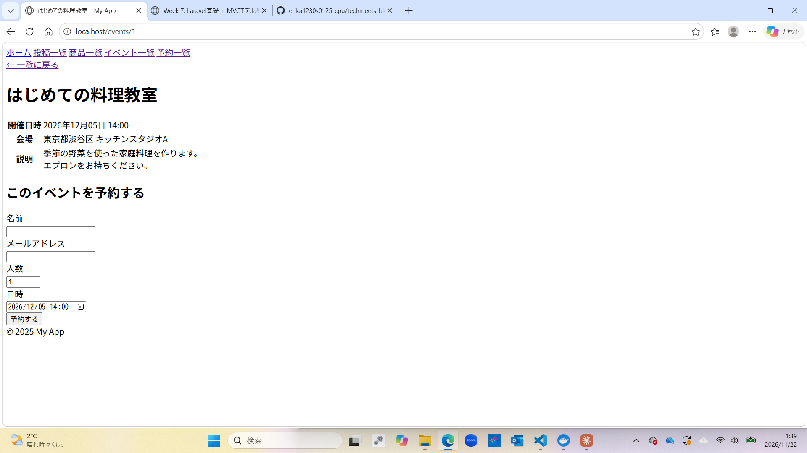
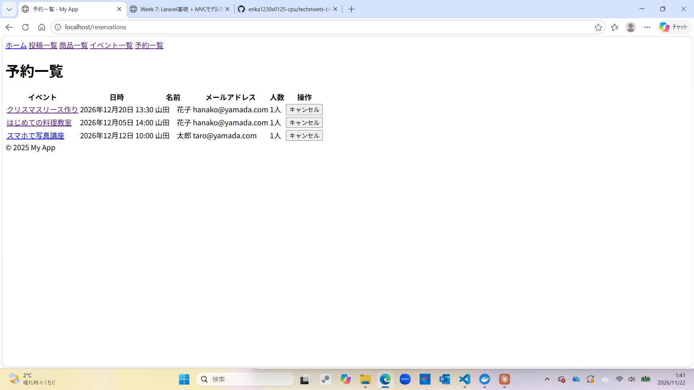

# 📝 techmeets-blog

techmeets の Week 6〜17 で作成するブログアプリのリポジトリです。
Week 6 では、Docker（Docker Compose）を使って Laravel の開発環境を構築しました。
Week 7 では、Laravel の MVC を使って、ブログ・商品管理・イベント予約の3つの機能を作成しました。
Week 8 では、Laravel Breeze でユーザー認証を追加し、ブログを会員制にして、コメント機能を作成しました。

---

## ✨ 機能（Week 8）

### 基本課題：会員制ブログ

| 機能 | URL | 内容 |
|---|---|---|
| ユーザー登録 | `GET /register` → `POST /register` | 名前・メールアドレス・パスワードで登録（Laravel Breeze） |
| ログイン | `GET /login` → `POST /login` | メールアドレスとパスワードでログイン |
| ログアウト | `POST /logout` | ブログ画面の上部のボタンからログアウト |
| ダッシュボード | `GET /dashboard` | ログイン後のページ（Breeze） |
| プロフィール編集 | `GET /profile` | 名前・メールアドレス・パスワードの変更（Breeze） |

ブログ（`/posts`）は、次のように変わりました。

| 操作 | 未ログイン | ログイン中 |
|---|---|---|
| 投稿一覧・投稿詳細を見る | ○ | ○ |
| 投稿を作成する | ✕（ログイン画面へ移動） | ○ |
| 投稿を編集・削除する | ✕（ログイン画面へ移動） | **自分の投稿だけ** ○（他人の投稿は 403） |

### 練習課題1：コメント機能（投稿詳細ページ）

| 機能 | URL | 内容 |
|---|---|---|
| コメント一覧 | `GET /posts/{id}` | 投稿詳細ページの下に、コメントと投稿者名・日時を表示。未ログインでも見られる |
| コメント投稿 | `POST /posts/{id}/comments` | ログインユーザーだけ投稿できる（1000文字まで） |
| コメント削除 | `DELETE /comments/{id}` | 自分のコメントだけ削除できる（他人のコメントは 403） |

投稿を削除すると、その投稿のコメントも一緒に削除されます。

### 練習課題2：セキュリティテスト

XSS・CSRF・SQLインジェクション・認証・認可・パスワード・`.env` の7項目をテストしました。結果は Week 8 のプルリクエストに記載しています。

### 工夫したこと

- **ルートの分け方**：`posts` の作成・編集・削除だけを `auth` ミドルウェアのグループに入れ、一覧と詳細は誰でも見られるようにした。`/posts/create` が `/posts/{post}` に吸い込まれないよう、ログインが必要なルートを先に書いている
- **認可チェックはコントローラーで行う**：編集・削除ボタンは投稿者にだけ表示するが、ボタンを隠すだけでは開発者ツールでフォームを書き換えれば送れてしまう。そのため `edit`・`update`・`destroy` のすべてで、投稿者とログインユーザーが違えば `abort(403)` にしている
- **投稿者の記録**：`user_id` はフォームから受け取らず、コントローラーで `auth()->id()` を入れている（他人になりすまして投稿できないようにするため）
- **ログアウトは POST**：ログアウトをリンク（GET）にすると、ほかのサイトから勝手にログアウトさせられる（CSRF）ため、`@csrf` 付きのフォームにしている
- **Week 7 の画面を残す**：Breeze が `layouts/app.blade.php` を上書きするため、Week 7 のレイアウトを `layouts/blog.blade.php` に移し、ブログ・商品・イベントの画面はそちらを使っている

---

## ✨ 機能（Week 7）

### 基本課題：ブログ（`/posts`）

| 機能 | URL | 内容 |
|---|---|---|
| 投稿一覧 | `GET /posts` | 新しい順に10件ずつ表示（ページネーション）。カテゴリーと本文の先頭100文字を表示 |
| 投稿詳細 | `GET /posts/{id}` | 本文の改行もそのまま表示 |
| 投稿作成 | `GET /posts/create` → `POST /posts` | タイトル・カテゴリー・本文を入力。未入力や文字数オーバーはエラーを表示 |
| 投稿編集 | `GET /posts/{id}/edit` → `PUT /posts/{id}` | 今の内容をフォームに表示し、更新後は詳細ページに戻る |
| 投稿削除 | `DELETE /posts/{id}` | 確認ダイアログで「OK」を押したときだけ削除 |

### 練習課題1：商品管理（`/products`）

| 機能 | URL | 内容 |
|---|---|---|
| 商品一覧 | `GET /products` | 表形式で10件ずつ表示。価格はカンマ区切り、在庫が0のときは「在庫切れ」と表示 |
| 商品詳細 | `GET /products/{id}` | 説明が空のときは「説明はありません」と表示 |
| 商品登録 | `GET /products/create` → `POST /products` | 商品名・カテゴリー・価格・在庫数・説明（任意）を入力。価格と在庫数は0以上の整数のみ |
| 商品編集 | `GET /products/{id}/edit` → `PUT /products/{id}` | 今の内容をフォームに表示し、更新後は詳細ページに戻る |
| 商品削除 | `DELETE /products/{id}` | 確認ダイアログで「OK」を押したときだけ削除 |

### 練習課題2：イベント予約（`/events`・`/reservations`）

| 機能 | URL | 内容 |
|---|---|---|
| イベント一覧 | `GET /events` | 開催日時の早い順に表示 |
| イベント詳細 | `GET /events/{id}` | イベントの情報と、予約フォームを表示 |
| 予約作成 | `POST /reservations` | 名前・メールアドレス・人数（1〜10人）・日時を入力。過去の日時や存在しないイベントへの予約はエラーにする |
| 予約一覧 | `GET /reservations` | 新しい順に表示。イベント名から、そのイベントの詳細ページに移動できる |
| 予約キャンセル | `DELETE /reservations/{id}` | 確認ダイアログで「OK」を押したときだけ削除 |

イベントの登録画面はありません。イベントは phpMyAdmin で `events` テーブルに直接追加します（[セットアップ手順](#-セットアップ手順)の手順8を参照）。

### 工夫したこと

- **入力チェック**：`$request->validate()` で入力をチェックし、エラーのときは入力した値を `old()` で残したままフォームに戻す
- **エラーメッセージの日本語化**：`lang/ja/validation.php` を作り、エラーメッセージを日本語で表示する。予約フォームでは、項目名を「名前」に上書きしている
- **XSS 対策**：画面への出力は `{{ }}` でエスケープする。改行を表示するところだけ `{!! nl2br(e(...)) !!}` を使い、エスケープしてから改行を `<br>` に変えている
- **CSRF 対策**：すべてのフォームに `@csrf` を付けている
- **削除の確認ダイアログ**：タイトルなどは JavaScript に直接埋め込まず、`data-name` 属性から読み取る
- **テーブルの関連付け**：予約は `event_id` でイベントとつながっている（外部キー制約あり）。モデルに `hasMany` / `belongsTo` を書き、予約一覧では `with('event')` で N+1 問題を防いでいる
- **タイムゾーン**：`config/app.php` を `Asia/Tokyo` にして、日時を日本時間で保存・表示する

---

## 📸 スクリーンショット

### ブログ

| 投稿一覧 | 投稿詳細 |
|---|---|
|  |  |

| 入力エラー |
|---|
|  |

### 商品管理

| 商品一覧 | 商品詳細 |
|---|---|
|  |  |

### イベント予約

| イベント一覧 | イベント詳細・予約フォーム |
|---|---|
|  |  |

| 予約一覧 |
|---|
|  |

---

## 🗄️ テーブル定義

`id`・`created_at`・`updated_at` は、すべてのテーブルにあります（下の表では省略）。

### users（ユーザー）

Laravel 標準のテーブルです（主なカラムのみ）。

| カラム | 型 | NULL | 説明 |
|---|---|---|---|
| `name` | VARCHAR(255) | ✕ | 名前 |
| `email` | VARCHAR(255) | ✕ | メールアドレス（重複不可） |
| `password` | VARCHAR(255) | ✕ | パスワード（bcrypt でハッシュ化して保存） |

### posts（投稿）

| カラム | 型 | NULL | 説明 |
|---|---|---|---|
| `user_id` | BIGINT UNSIGNED | ✕ | 投稿者の ID（`users.id` への外部キー）※Week 8 で追加 |
| `title` | VARCHAR(200) | ✕ | タイトル |
| `content` | TEXT | ✕ | 本文 |
| `category` | VARCHAR(50) | ✕ | カテゴリー |

### comments（コメント）※Week 8 で追加

| カラム | 型 | NULL | 説明 |
|---|---|---|---|
| `post_id` | BIGINT UNSIGNED | ✕ | 投稿の ID（`posts.id` への外部キー。投稿を削除するとコメントも削除される） |
| `user_id` | BIGINT UNSIGNED | ✕ | コメントした人の ID（`users.id` への外部キー） |
| `content` | TEXT | ✕ | コメント本文 |

```
users 1 ──── * posts
users 1 ──── * comments
posts 1 ──── * comments
（1人のユーザーがたくさんの投稿・コメントを書き、1つの投稿にたくさんのコメントが付く）
```

### products（商品）

| カラム | 型 | NULL | 説明 |
|---|---|---|---|
| `name` | VARCHAR(100) | ✕ | 商品名 |
| `price` | INT UNSIGNED | ✕ | 価格（0以上） |
| `description` | TEXT | ○ | 説明 |
| `stock` | INT UNSIGNED | ✕ | 在庫数（0以上、初期値 0） |
| `category` | VARCHAR(50) | ✕ | カテゴリー |

### events（イベント）

| カラム | 型 | NULL | 説明 |
|---|---|---|---|
| `title` | VARCHAR(100) | ✕ | イベント名 |
| `description` | TEXT | ○ | 説明 |
| `location` | VARCHAR(100) | ✕ | 会場 |
| `starts_at` | DATETIME | ✕ | 開催日時 |

### reservations（予約）

| カラム | 型 | NULL | 説明 |
|---|---|---|---|
| `event_id` | BIGINT UNSIGNED | ✕ | イベントの ID（`events.id` への外部キー。イベントを削除すると予約も削除される） |
| `name` | VARCHAR(50) | ✕ | 名前 |
| `email` | VARCHAR(255) | ✕ | メールアドレス |
| `number_of_people` | INT UNSIGNED | ✕ | 人数 |
| `reserved_at` | DATETIME | ✕ | 予約日時 |

```
events 1 ──── * reservations
（1つのイベントに、たくさんの予約がある）
```

---

## 🛠️ 使用技術

| 分類 | 技術 |
|---|---|
| フレームワーク | Laravel 12 |
| 認証 | Laravel Breeze（Blade） |
| 言語 | PHP 8.2（PHP-FPM） |
| フロントエンド | Tailwind CSS / Vite（Breeze の画面で使用） |
| Web サーバー | Nginx |
| データベース | MySQL 8.0 / phpMyAdmin |
| 環境 | Docker / Docker Compose |

---

## 🐳 コンテナ構成

| サービス名 | 役割 | URL・ポート |
|---|---|---|
| `nginx` | Web サーバー。ブラウザからのリクエストを受け付ける | http://localhost |
| `app` | PHP-FPM。Laravel（PHP）を実行する | 9000（コンテナ内のみ） |
| `db` | MySQL。データを保存する | localhost:3306 |
| `phpmyadmin` | ブラウザから MySQL を操作する管理ツール | http://localhost:8080 |

リクエストの流れ：ブラウザ → `nginx` → `app` → `db`

---

## 📁 ディレクトリ構成

```
laravel-docker-app/
├── docker/
│   ├── nginx/
│   │   └── default.conf    # Nginx の設定
│   └── php/
│       └── Dockerfile      # PHP（app コンテナ）のイメージ設定
├── docs/
│   └── images/             # README 用のスクリーンショット
├── src/                    # Laravel プロジェクト
├── docker-compose.yml      # コンテナの構成
├── .env.example            # Docker 用の環境変数のサンプル
└── README.md
```

---

## 🚀 セットアップ手順

### 前提

- Docker Desktop をインストールし、起動して「Engine running」になっていること
- ホストPCに Node.js（npm）がインストールされていること（`node -v` でバージョンが表示されれば OK）
- ポート 80・3306・8080 がほかのソフト（XAMPP など）で使われていないこと

### 1. リポジトリをクローンする

```bash
git clone https://github.com/erika1230s0125-cpu/techmeets-blog.git
cd techmeets-blog
```

### 2. Docker 用の `.env` を作る

```bash
cp .env.example .env
```

ポート番号を変えたい場合は、`.env` の値を書き換えます。

### 3. コンテナを起動する

```bash
docker compose up -d --build
```

初回はイメージのビルドがあるため、数分かかります。`docker compose ps` で 4 つのコンテナが `running` になっていれば OK です。

### 4. Laravel のパッケージをインストールする

`src/vendor/` は Git で管理していないため、Composer でインストールします。

```bash
docker compose exec -e COMPOSER_PROCESS_TIMEOUT=0 app composer install
```

> 💡 Windows では、ファイルの展開に時間がかかり、Composer が時間切れ（300秒）で止まることがあります。`COMPOSER_PROCESS_TIMEOUT=0` で制限時間をなくしています。

### 4-2. フロントエンドをビルドする（ホストPCで実行）

Breeze の画面（登録・ログインなど）は Tailwind CSS を使っているため、CSS のビルドが必要です。ビルド結果の `src/public/build/` は Git で管理していません。
app コンテナには Node.js が入っていないため、**ホストPC**の `src/` で実行します。

```bash
cd src
npm install
npm run build
cd ..
```

### 5. Laravel 用の `.env` を作る

```bash
cp src/.env.example src/.env
```

`src/.env` のデータベース設定を、次のように書き換えます（`DB_HOST` は docker-compose.yml のサービス名 `db`）。

```ini
DB_CONNECTION=mysql
DB_HOST=db
DB_PORT=3306
DB_DATABASE=laravel
DB_USERNAME=root
DB_PASSWORD=secret
```

### 6. アプリケーションキーを作り、権限を設定する

```bash
docker compose exec app php artisan key:generate
docker compose exec app chown -R www-data:www-data storage bootstrap/cache
docker compose exec app chmod -R 775 storage bootstrap/cache
```

### 7. マイグレーションを実行する

```bash
docker compose exec app php artisan migrate
```

### 8. イベントのデータを登録する

イベントの登録画面はないため、http://localhost:8080（phpMyAdmin）で `laravel` データベースを選び、「SQL」タブで次の SQL を実行します。

```sql
INSERT INTO events (title, description, location, starts_at, created_at, updated_at) VALUES
('はじめての料理教室', '季節の野菜を使った家庭料理を作ります。\nエプロンをお持ちください。', '東京都渋谷区 キッチンスタジオA', '2026-12-05 14:00:00', NOW(), NOW()),
('スマホで写真講座', 'スマートフォンできれいな写真を撮るコツを学びます。', '東京都新宿区 文化センター 3階', '2026-12-12 10:00:00', NOW(), NOW()),
('クリスマスリース作り', NULL, '神奈川県横浜市 市民ホール', '2026-12-20 13:30:00', NOW(), NOW());
```

> 💡 過去の日時には予約できないため、`starts_at` は今日より後の日時にしてください。

### 9. ブラウザで確認する

| URL | 確認すること |
|---|---|
| http://localhost/register | ユーザー登録画面が表示され、登録するとダッシュボードに移動する |
| http://localhost/login | ログイン画面が表示される |
| http://localhost/posts | 投稿一覧が表示される（ログインすると「新規投稿」が表示される） |
| http://localhost/products | 商品一覧が表示される |
| http://localhost/events | イベント一覧が表示される |
| http://localhost/reservations | 予約一覧が表示される |
| http://localhost:8080 | phpMyAdmin で `laravel` データベースのテーブルが見える |

### 作業を終えるとき

```bash
docker compose down
```

データベースのデータは `db-data` ボリュームに保存されるため、コンテナを削除しても消えません。

---

## 🧰 よく使うコマンド

| やりたいこと | コマンド |
|---|---|
| コンテナを起動する | `docker compose up -d` |
| コンテナを停止・削除する | `docker compose down` |
| コンテナの状態を見る | `docker compose ps` |
| ログを見る | `docker compose logs app` |
| app コンテナに入る | `docker compose exec app bash` |
| Artisan コマンドを実行する | `docker compose exec app php artisan <コマンド>` |

---

## ⚠️ トラブルシューティング

| 症状 | 対処 |
|---|---|
| `failed to connect to the docker API` | Docker Desktop を起動する |
| `port is already allocated` | 同じポートを使っているソフトを止めるか、`.env` のポート番号を変える |
| Composer が `exceeded the timeout of 300 seconds` で止まる | 手順4のように `COMPOSER_PROCESS_TIMEOUT=0` を付けて `composer install` をやり直す |
| `No application encryption key has been specified.` | `docker compose exec app php artisan key:generate` を実行する |
| データベースに接続できない | `src/.env` の `DB_CONNECTION` が `mysql`、`DB_HOST` が `db` になっているか確認する |
| `Permission denied` | 手順6の `chown` と `chmod` をもう一度実行する |
| `Vite manifest not found` | 手順4-2の `npm install` と `npm run build` を、ホストPCの `src/` で実行する |
| `419 Page Expired` | ページを再読み込みしてから、もう一度送信する（CSRF トークンの期限切れ） |
